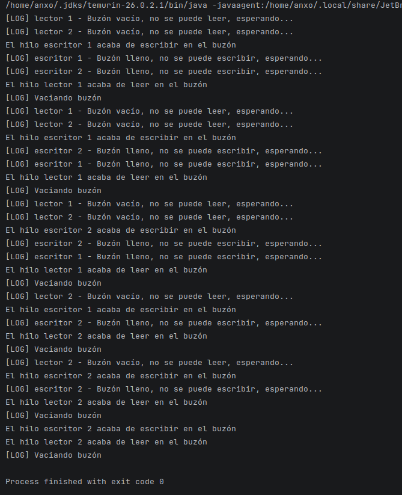

# Optativa 1

## Alumno

- Anxo Vázquez Lorenzo

## Asignatura

- PSP

## Enunciado

Un buzón guarda un único mensaje. Dos hilos escritores mandan 3 mensajes cada uno y dos hilos lectores leen 3 mensajes cada uno. Un escritor solo puede escribir si el buzón está vacío y un lector solo puede leer si tiene un mensaje, si no, esperan. Muestra por pantalla quién escribe, quién lee y quién espera.

## Clase `Buzon` - Métodos escribir y leer

Esta clase simula un buzón al que solo le cabe un mensaje, es decir, no se pueden escribir dos (o más) mensajes a la vez se tiene que esperar a que se lea uno para poder escribir otro y viceversa, no se puede leer hasta que no haya un mensaje.

Para ello en la clase `Buzon` empleo los siguientes métodos:

```java
/**
     * Método sincronizado que escribe en el buzón, al entrar comprueba si está lleno o no, si lo está hace un await() hasta que un hilo lector lo vacíe, si no, escribe en el buzón y manda una señal a todos los hilos (notifyAll)
     * @param texto texto que a escribir
     * @param nombreHiloEmisor el nombre del hilo que llama a este método
     */
    public synchronized void escribir(String texto, String nombreHiloEmisor) {
        while(mensaje.compareTo("") != 0){ //mientras esté lleno
            System.out.println("[LOG] " + nombreHiloEmisor + " - Buzón lleno, no se puede escribir, esperando...");

            try{
                wait(); //el hilo espera hasta recibir una señal
            } catch (InterruptedException e) {
                throw new RuntimeException(e);
            }
        }

        this.mensaje = texto;
        System.out.println("El hilo " + nombreHiloEmisor + " acaba de escribir en el buzón");
        notifyAll(); //notifica a todos los hilos
    }

    /**
     * Método que lee y devuelve un String con el mensaje, si el mensaje está vacío el hilo hace un await() hasta que un escritor lo esciba, una vez leído lo vacía para que un escritor lo pueda escribir
     * @param nombreHiloEmisor el nombre del hilo que llama a este método
     * @return mensaje
     */
    public synchronized String leer(String nombreHiloEmisor){
        while(this.mensaje.compareTo("") == 0){ //mientras esté vacío
            System.out.println("[LOG] " + nombreHiloEmisor + " - Buzón vacío, no se puede leer, esperando...");
            try{
                wait(); //el hilo espera hasta recibir una señal
            } catch (InterruptedException e) {
                throw new RuntimeException(e);
            }
        }

        System.out.println("El hilo " + nombreHiloEmisor + " acaba de leer en el buzón");
        String textoAdevolver = this.mensaje;
        System.out.println("[LOG] Vaciando buzón");
        this.mensaje =""; //Cuando se lee un mensaje ese mensaje se elimina
        notifyAll(); //notifica a todos los hilos
        return textoAdevolver;
    }
```

## Método `run` de `Hilo`

Creo una clase llamada `Hilo` (que hereda de `Thread`) y creo este método el cual detecta el rol del hilo (escritor o lector) y manda 3 operaciones por hilo:

```java
/**
     * Método run con bucle que hace tres iteraciones para hacer operaciones sobre el buzón
     */
    @Override
    public void run(){
        //manda 3 operaciones por hilo
        for(int i = 0;i<3;i++) {
            if (this.esEscritor) {
                this.b.escribir("Escritor por " + super.getName(), super.getName());
            } else {
                this.b.leer(super.getName());
            }
        }
    }
```

## Ejecución



## Bibliografía

- Makigas - Ejemplos wait() y notify()

    https://www.makigas.es/series/concurrencia-en-java/ejemplo-de-wait-notify

> No he necesitado IA para esta tarea